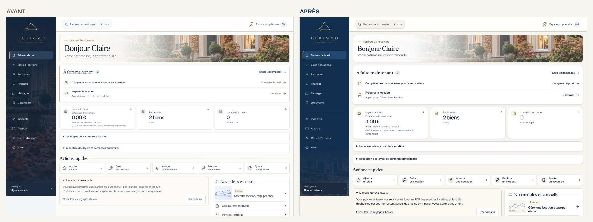
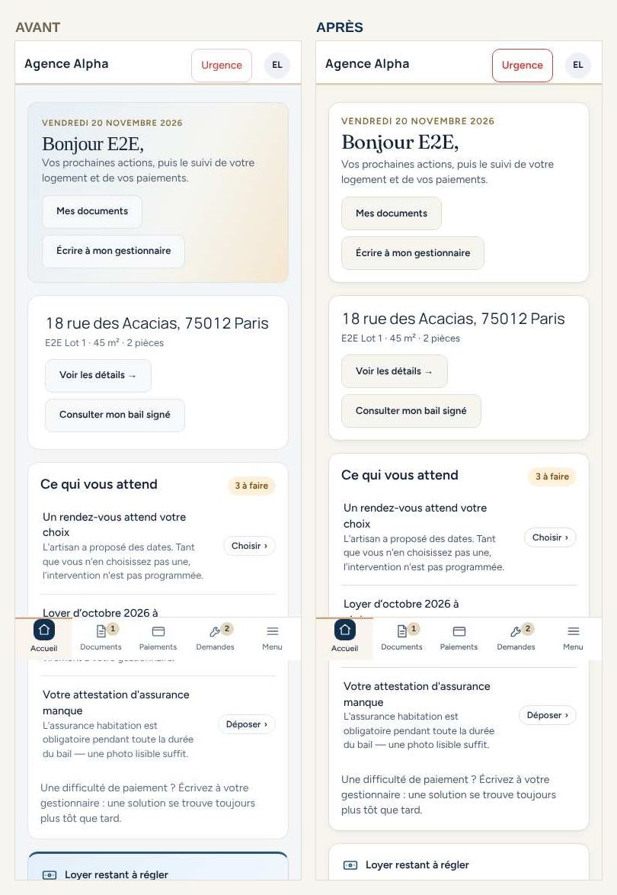
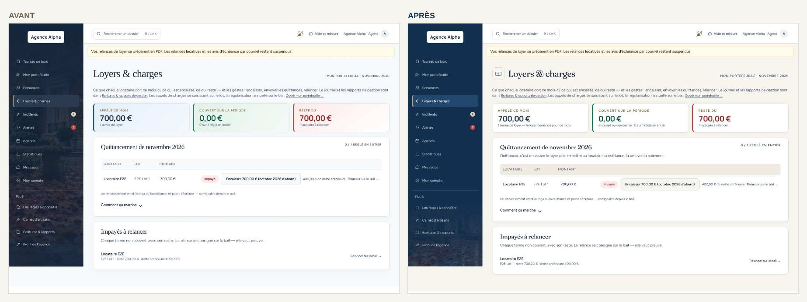
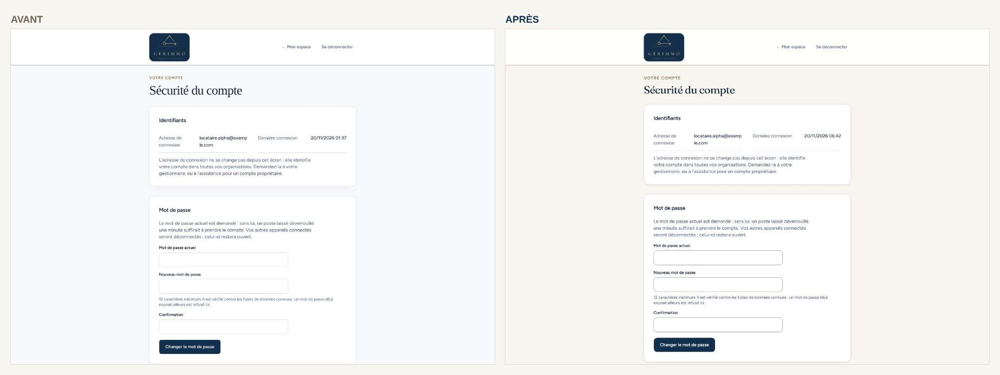

# Gerimmo — Refonte visuelle : synthèse pour le dirigeant

**20 novembre 2026.** Le travail est prêt à être relu ; l'intégration continue garde une étape rouge (parcours WebKit mobile), expliquée plus bas. **Rien n'est fusionné, rien n'est en production.**

## En trois phrases

Gerimmo fonctionnait, mais il était inégal : chaque espace avait ses couleurs, ses titres et ses boutons, et certaines pages donnaient l'impression de sortir du logiciel.
J'ai posé une identité commune, « Maison » (papier chaud, bleu nuit, trait de champagne, titres à empattements), puis je l'ai appliquée aux **133 pages**, dans **toutes les sessions**.
Sur le banc, tout est vert (12 949 tests unitaires, 282 parcours navigateur, 932 passages d'écran sans erreur) ; **l'intégration continue reste rouge sur une étape, les parcours WebKit mobile**, que je ne peux pas lire d'ici.

## Ce qui change pour l'utilisateur

| Avant | Après |
|---|---|
| Des titres qui changeaient de dessin selon l'appareil (police absente d'Android) | Une police de titre embarquée, la même partout |
| 14 tailles de titre d'écran | Une seule |
| Bouton principal or chez le locataire, bleu ailleurs | Bleu nuit partout ; la couleur d'une agence en marque blanche reste respectée |
| Conditions, aide, compte : la page s'ouvrait avec « Se connecter » et « Créer mon compte », sans retour | Un bandeau « Revenir à mon espace… » ramène à la page d'où l'on vient |
| Une erreur faisait disparaître le menu | L'erreur et la page introuvable restent dans l'espace, avec un bouton vers l'accueil |
| Dégradés et bords colorés sans signification | Une couleur dit un état (retard, attention), jamais un décor |
| Supervision : trois styles, texte de 10 px, jargon technique | Un seul style, rien sous 12 px, une phrase en clair devant chaque identifiant technique |
| Espace artisan à part, avec ses propres couleurs | Le même Gerimmo que les autres espaces |

## Six captures représentatives (avant à gauche, après à droite)

Mêmes conditions des deux côtés : construction de production, mêmes comptes fictifs, même largeur.

**Propriétaire — accueil**

**Locataire — accueil, au téléphone**

**Artisan — accueil**

**Supervision — « Aujourd'hui »**

**Agence — loyers**

**Page hors espace — sécurité du compte, avec le bandeau de retour**

Les 38 comparaisons sont dans le dossier [captures/](captures/).

## Avancement

| Session | Pages trouvées | Auditées (code) | Auditées (navigateur) | Améliorées | Testées (4 largeurs) | Relues à l’œil | Terminées |
|---|---:|---:|---:|---:|---:|---:|---:|
| Propriétaire (particulier et SCI) | 34 | 34 (100 %) | 25 (74 %) | 32 (94 %) | 34 (100 %) | 34 (100 %) | 34 (100 %) |
| Gestionnaire d’agence | 27 | 27 (100 %) | 26 (96 %) | 25 (93 %) | 27 (100 %) | 27 (100 %) | 27 (100 %) |
| Administrateur d’agence | 34 | 34 (100 %) | 28 (82 %) | 32 (94 %) | 34 (100 %) | 34 (100 %) | 34 (100 %) |
| Locataire | 13 | 13 (100 %) | 12 (92 %) | 13 (100 %) | 13 (100 %) | 13 (100 %) | 13 (100 %) |
| Artisan | 22 | 22 (100 %) | 18 (82 %) | 22 (100 %) | 22 (100 %) | 22 (100 %) | 22 (100 %) |
| Super-administrateur (supervision) | 33 | 33 (100 %) | 33 (100 %) | 33 (100 %) | 33 (100 %) | 33 (100 %) | 33 (100 %) |
| Relais et veille | 2 | 2 (100 %) | 2 (100 %) | 2 (100 %) | 2 (100 %) | 2 (100 %) | 2 (100 %) |
| Pages publiques | 22 | 22 (100 %) | 21 (95 %) | 22 (100 %) | 22 (100 %) | 22 (100 %) | 22 (100 %) |
| Pages transversales | 5 | 5 (100 %) | 5 (100 %) | 5 (100 %) | 5 (100 %) | 5 (100 %) | 5 (100 %) |
| **Total (page × session)** | **192** | 192 (100 %) | 170 (89 %) | 186 (97 %) | 192 (100 %) | 192 (100 %) | **192 (100 %)** |

**Avancement global : 100 % des 192 lignes page × session sont améliorées, testées dans le navigateur et relues ; 0 % en production.** « Terminé » veut dire ici : page harmonisée, ouverte aux quatre largeurs sans erreur ni débordement ni défaut grave d'accessibilité, et capture relue à 375 et 1440 px. Cela ne veut pas dire : essayé sur un vrai téléphone, fusionné, ni publié. **Et l'intégration continue n'est pas encore verte** (voir plus bas).

| Étape | État |
|---|---|
| Inventaire des pages | terminé — 133 pages |
| Audit | terminé — 559 constats |
| Direction visuelle et Design System | terminé |
| Développement | terminé pour les 133 pages — 17 commits sur la branche, 307 fichiers |
| Tests | banc : tout est vert (0 erreur de style, 0 erreur de type, construction réussie, 12 949 tests unitaires, 282 parcours Chromium, 932 passages du second parcours) ; **intégration continue : rouge sur l'étape WebKit mobile**, cause non lisible depuis le banc |
| Pull request | ouverte, **non fusionnée, pas encore prête** — [#350](https://github.com/GERIMMO/GERIMMO_V4/pull/350) ; intégration continue rouge sur l'étape WebKit mobile |
| Mise en production | **non faite** — elle demande votre accord |

## Résultats des tests

Les essais sont faits sur un **banc** : un environnement isolé, sur la machine de travail, avec des données fictives. Rien n'a touché la production.

| Contrôle | Résultat |
|---|---|
| Style du code, types, construction | 0 erreur |
| Tests unitaires et d'intégration | **12 949 réussis, 0 échec** |
| Parcours navigateur de la suite (Chromium) | **0 échec** : 282 réussis, puis 281 + 1 instable sur le commit final |
| Second parcours de tous les écrans, 4 largeurs | **932 passages, 0 erreur, 0 débordement** |
| Accessibilité automatique (axe, WCAG 2.2 AA) | **0 défaut grave** (36 éléments avant) |
| Parcours dans un vrai moteur WebKit (celui de Safari) | 180 écrans à 390 px et à 360 px : 1 débordement trouvé, corrigé |
| Intégration continue (GitHub) | **rouge** sur `9a656950` : étape WebKit mobile ; le reste est vert |
| Protections SEC-1, second facteur, SCI, calculs | préservées : aucun fichier de logique modifié, tests verts |

Détail : [NON-REGRESSION.md](NON-REGRESSION.md).

## Ce qui reste

**À faire avant publication**

1. **Essayer sur de vrais appareils** : un iPhone (Safari) et un téléphone Android. Tous les essais « téléphone » de cette mission sont simulés.
2. **Votre relecture** de la pull request et des captures.

**Ce qui n'est pas terminé, et pourquoi**

| Sujet | État | Raison |
|---|---|---|
| Écrans propres à la SCI | non relus à l'œil | pas de compte SCI sur le banc ; couverts par les tests automatiques |
| Pages très longues (bail, fiche d'un lot, fiche d'une personne) | hiérarchie améliorée, pas découpées | les découper change la structure que les tests vérifient : c'est un chantier à part |
| Blocs repliés empilés côté propriétaire (accueil, finances) | inchangés | même raison |
| Libellés jugés peu clairs mais vérifiés par des tests (« À faire », « à qualifier », « appelés ») | inchangés | à décider avec vous, puis changer le texte et le test ensemble |
| Supervision : nom du menu différent du titre (« Vue d'ensemble » / « Aujourd'hui ») | inchangé | les tests figent les deux côtés |
| Marque blanche : l'assistant de l'espace locataire dit « Demander à Gerimmo » | inchangé | un test navigateur exige ce libellé pour une agence sans marque propre ; le rendre neutre demande de lire la marque de l'agence dans le composant |
| Marque blanche : logo Gerimmo sur l'invitation du locataire et la signature du garant | inchangé | ces deux écrans utilisent le gabarit commun de connexion, qui ne connaît pas l'agence |
| Feuilles communes historiques (`globals.css`, `prestige.css`) | encore 228 couleurs en dur | ce sont surtout les définitions des jetons et les palettes de saison ; les blocs « vitrine » et « outils » de `globals.css` sont à déplacer |
| Libellés de la barre basse du téléphone (10 à 10,5 px) | exception assumée | cinq entrées doivent tenir sur 375 px |
| Les 338 remarques des lots (annexe C) | à trier | pistes d'amélioration relevées en chemin, hors d'un chantier de présentation |
| Performance (Lighthouse) et lecteur d'écran réel | non mesurés | hors de ce que le banc permet de prouver |

## Ce que j'attends de vous

1. **Regarder** : les captures avant / après, puis la pull request [#350](https://github.com/GERIMMO/GERIMMO_V4/pull/350).
2. **Décider** : fusionner ou non. Je ne fusionne pas sans votre accord écrit.
3. **Essayer sur un vrai téléphone** avant publication : tous mes essais « téléphone » sont simulés dans un navigateur d'ordinateur.

## Prochaine étape recommandée

**Me donner l'accès qui manque pour lire l'échec WebKit**, de l'une de ces deux façons : (a) autoriser l'hôte `cdn.playwright.dev` dans l'environnement (réglages de l'environnement cloud, accès réseau) : j'installe alors le même WebKit que la CI et je reproduis l'échec ; ou (b) ouvrir le run sur GitHub, étape « Vérifier les parcours essentiels sur WebKit mobile », et me coller le nom du test en échec. Ensuite seulement : relecture, essai sur de vrais téléphones, décision de fusion.

## Où tout se trouve

| | |
|---|---|
| Code | pull request [#350](https://github.com/GERIMMO/GERIMMO_V4/pull/350), branche `claude/refonte-design-gerimmo` |
| Rapport d'audit complet | [RAPPORT-AUDIT.md](RAPPORT-AUDIT.md) |
| Rapport de non-régression | [NON-REGRESSION.md](NON-REGRESSION.md) |
| Design System | [DESIGN-SYSTEM.md](DESIGN-SYSTEM.md) |
| Prototypes des trois directions | [canevas « Gerimmo — directions visuelles »](https://claude.ai/artifact/22UMhhxGxRdEV2Hxj1fbNz) (privé : visible avec votre compte) |
| Inventaire des 133 pages | [annexes/inventaire-pages.md](annexes/inventaire-pages.md) |
| Matrice de suivi page par page | [annexes/matrice-pages.md](annexes/matrice-pages.md) |
| Remarques laissées par les lots (338) | [annexes/remarques-restantes.md](annexes/remarques-restantes.md) |
