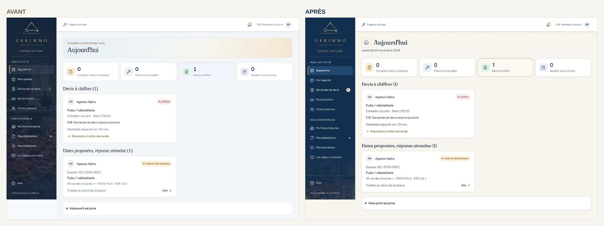
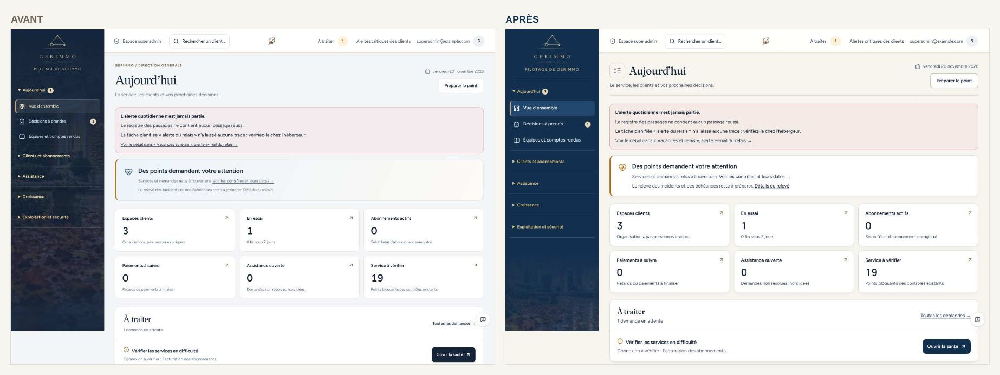
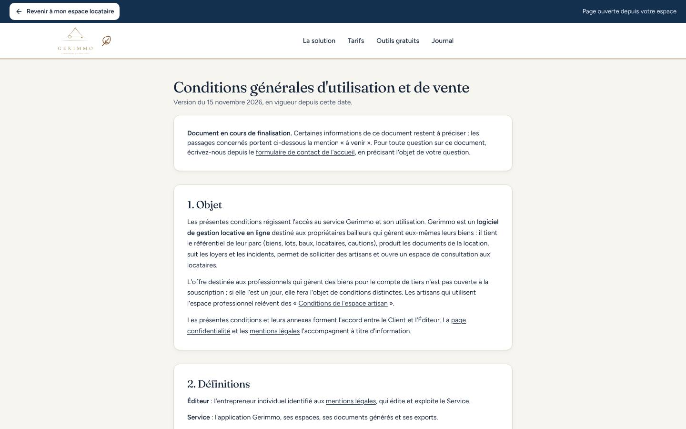

# Gerimmo — Refonte visuelle : synthèse pour le dirigeant

**20 novembre 2026.** Tout est prêt à être relu, et l'intégration continue est verte. **Rien n'est fusionné, rien n'est en production.**

## En trois phrases

Gerimmo fonctionnait, mais il était inégal : chaque espace avait ses couleurs, ses titres et ses boutons, et certaines pages donnaient l'impression de sortir du logiciel.
J'ai posé une identité commune, « Maison » (papier chaud, bleu nuit, trait de champagne, titres à empattements), puis je l'ai appliquée aux **133 pages**, dans **toutes les sessions**.
Tout est vérifié : 12 952 tests unitaires, 282 parcours navigateur, 932 passages d'écran sans erreur, et l'intégration continue est verte.

## Ce qui change pour l'utilisateur

| Avant | Après |
|---|---|
| Des titres qui changeaient de dessin selon l'appareil (police absente d'Android) | Une police de titre embarquée, la même partout |
| 14 tailles de titre d'écran | Une seule |
| Bouton principal or chez le locataire, bleu ailleurs | Bleu nuit partout ; la couleur d'une agence en marque blanche reste respectée |
| Conditions, aide, compte : la page s'ouvrait avec « Se connecter » et « Créer mon compte », sans retour | Un bandeau « Revenir à mon espace… » ramène à la page d'où l'on vient |
| Une erreur faisait disparaître le menu | L'erreur et la page introuvable restent dans l'espace, avec un bouton vers l'accueil |
| Dégradés et bords colorés sans signification | Une couleur dit un état (retard, attention), jamais un décor |
| Supervision : trois styles, texte de 10 px, jargon technique | Un seul style, rien sous 12 px, une phrase en clair devant chaque identifiant technique |
| Espace artisan à part, avec ses propres couleurs | Le même Gerimmo que les autres espaces |

## Six captures représentatives (avant à gauche, après à droite)

Mêmes conditions des deux côtés : construction de production, mêmes comptes fictifs, même largeur.

**Propriétaire — accueil**

**Locataire — accueil, au téléphone**

**Artisan — accueil**

**Supervision — « Aujourd'hui »**

**Agence — loyers**

**Page hors espace — sécurité du compte**

**Nouveau — le bandeau « Revenir à mon espace »** (ici les conditions générales, ouvertes depuis l'espace locataire ; il n'existait pas avant)

Les 38 comparaisons et les deux captures du bandeau sont dans le dossier [captures/](captures/).

## Avancement

| Session | Pages trouvées | Auditées (code) | Auditées (navigateur) | Améliorées | Testées (4 largeurs) | Relues à l’œil | Terminées |
|---|---:|---:|---:|---:|---:|---:|---:|
| Propriétaire (particulier et SCI) | 34 | 34 (100 %) | 25 (74 %) | 32 (94 %) | 34 (100 %) | 34 (100 %) | 34 (100 %) |
| Gestionnaire d’agence | 27 | 27 (100 %) | 26 (96 %) | 25 (93 %) | 27 (100 %) | 27 (100 %) | 27 (100 %) |
| Administrateur d’agence | 34 | 34 (100 %) | 28 (82 %) | 32 (94 %) | 34 (100 %) | 34 (100 %) | 34 (100 %) |
| Locataire | 13 | 13 (100 %) | 12 (92 %) | 13 (100 %) | 13 (100 %) | 13 (100 %) | 13 (100 %) |
| Artisan | 22 | 22 (100 %) | 18 (82 %) | 22 (100 %) | 22 (100 %) | 22 (100 %) | 22 (100 %) |
| Super-administrateur (supervision) | 33 | 33 (100 %) | 33 (100 %) | 33 (100 %) | 33 (100 %) | 33 (100 %) | 33 (100 %) |
| Relais et veille | 2 | 2 (100 %) | 2 (100 %) | 2 (100 %) | 2 (100 %) | 2 (100 %) | 2 (100 %) |
| Pages publiques | 22 | 22 (100 %) | 21 (95 %) | 22 (100 %) | 22 (100 %) | 22 (100 %) | 22 (100 %) |
| Pages transversales | 5 | 5 (100 %) | 5 (100 %) | 5 (100 %) | 5 (100 %) | 5 (100 %) | 5 (100 %) |
| **Total (page × session)** | **192** | 192 (100 %) | 170 (89 %) | 186 (97 %) | 192 (100 %) | 192 (100 %) | **192 (100 %)** |

**Avancement global : 100 % des 192 lignes page × session sont améliorées, testées dans le navigateur et relues ; 0 % en production.** « Terminé » veut dire ici : page harmonisée, ouverte aux quatre largeurs sans erreur ni débordement ni défaut grave d'accessibilité, et capture relue à 375 et 1440 px. Cela ne veut pas dire : essayé sur un vrai téléphone, fusionné, ni publié.

| Étape | État |
|---|---|
| Inventaire des pages | terminé — 133 pages |
| Audit | terminé — 559 constats |
| Direction visuelle et Design System | terminé |
| Développement | terminé pour les 133 pages — 19 commits sur la branche, 307 fichiers |
| Tests | banc : 0 erreur de style, 0 erreur de type, construction réussie, 12 952 tests unitaires réussis, 282 parcours Chromium réussis, 72 parcours WebKit réussis, 932 passages du second parcours sans défaut ; intégration continue verte |
| Pull request | ouverte, **prête à relire, non fusionnée** — [#350](https://github.com/GERIMMO/GERIMMO_V4/pull/350) ; intégration continue verte |
| Mise en production | **non faite** — elle demande votre accord |

## Résultats des tests

Les essais sont faits sur un **banc** : un environnement isolé, sur la machine de travail, avec des données fictives. Rien n'a touché la production.

| Contrôle | Résultat |
|---|---|
| Style du code, types, construction | 0 erreur |
| Tests unitaires et d'intégration | **12 952 réussis, 0 échec** |
| Parcours navigateur de la suite (Chromium) | **282 réussis, 0 échec**, 3 ignorés |
| Parcours navigateur de la suite (WebKit, le moteur de Safari) | **72 réussis sur 75** sur le banc (3 échecs propres au banc, vus aussi sur `main`) ; étape WebKit **verte dans l'intégration continue** |
| Second parcours de tous les écrans, 4 largeurs | **932 passages, 0 erreur, 0 débordement** |
| Accessibilité automatique (axe, WCAG 2.2 AA) | **0 défaut grave** (36 éléments avant) |
| Les 180 écrans dans un moteur WebKit, à 390 et 360 px | 1 débordement trouvé, corrigé |
| Intégration continue (GitHub) | **verte** sur `656fe141` |
| Protections SEC-1, second facteur, SCI, calculs | préservées : aucun fichier de logique modifié, tests verts |

Détail : [NON-REGRESSION.md](NON-REGRESSION.md).

## Ce qui s'est passé pendant la nuit, en clair

L'**intégration continue** est le contrôle automatique que GitHub lance sur chaque version du code. Elle a refusé la refonte trois fois, et **elle avait raison les trois fois**.

1. **Un fondu à l'ouverture des écrans.** Je l'avais ajouté pour adoucir l'arrivée d'une page. Pendant un quart de seconde le texte était à demi transparent, donc pas assez contrasté. Je l'ai retiré.
2. **Un écran figé dans Safari.** Pour alléger les pages, j'avais déclaré deux fichiers de la police de titre « à charger seulement si besoin ». Le moteur de Safari réagit mal à cela : il attend la fin du chargement avant d'afficher quoi que ce soit. Sur un réseau lent, un utilisateur d'iPhone aurait vu « Chargement de la page… » rester à l'écran plusieurs secondes. Chrome ne fait pas cela : mes essais ne pouvaient pas le voir, c'est le test Safari du dépôt qui l'a attrapé. J'ai corrigé (les polices se chargent d'emblée, et j'ai retiré un fichier italique de 81 Ko qui ne servait qu'à une phrase de l'accueil) et ajouté un test pour que cela ne revienne pas.
3. **Ce qui m'a ralenti.** Le journal de ce test et le moteur de Safari utilisé par GitHub étaient hors de portée de mon environnement de travail. J'ai d'abord suivi une fausse piste (le simulateur de prix de la vitrine), puis je vous ai demandé l'accès à un site de téléchargement (`cdn.playwright.dev`). Une fois l'accès donné, j'ai reproduit l'échec, trouvé la cause et prouvé le correctif.

**Où en est l'intégration continue :** Elle est **verte** sur le dernier commit.

## Ce qui reste

**À faire avant publication**

1. **Essayer sur de vrais appareils** : un iPhone (Safari) et un téléphone Android. Tous les essais « téléphone » de cette mission sont simulés.
2. **Votre relecture** de la pull request et des captures.

**Ce qui n'est pas terminé, et pourquoi**

| Sujet | État | Raison |
|---|---|---|
| Écrans propres à la SCI | non relus à l'œil | pas de compte SCI sur le banc ; couverts par les tests automatiques |
| Pages très longues (bail, fiche d'un lot, fiche d'une personne) | hiérarchie améliorée, pas découpées | les découper change la structure que les tests vérifient : c'est un chantier à part |
| Blocs repliés empilés côté propriétaire (accueil, finances) | inchangés | même raison |
| Libellés jugés peu clairs mais vérifiés par des tests (« À faire », « à qualifier », « appelés ») | inchangés | à décider avec vous, puis changer le texte et le test ensemble |
| Supervision : nom du menu différent du titre (« Vue d'ensemble » / « Aujourd'hui ») | inchangé | les tests figent les deux côtés |
| Marque blanche : l'assistant de l'espace locataire dit « Demander à Gerimmo » | inchangé | un test navigateur exige ce libellé pour une agence sans marque propre ; le rendre neutre demande de lire la marque de l'agence dans le composant |
| Marque blanche : logo Gerimmo sur l'invitation du locataire et la signature du garant | inchangé | ces deux écrans utilisent le gabarit commun de connexion, qui ne connaît pas l'agence |
| Feuilles communes historiques (`globals.css`, `prestige.css`) | encore 228 couleurs en dur | ce sont surtout les définitions des jetons et les palettes de saison ; les blocs « vitrine » et « outils » de `globals.css` sont à déplacer |
| Libellés de la barre basse du téléphone (10 à 10,5 px) | exception assumée | cinq entrées doivent tenir sur 375 px |
| Les 338 remarques des lots (annexe C) | à trier | pistes d'amélioration relevées en chemin, hors d'un chantier de présentation |
| Polices préchargées : 126 Ko de plus par première visite (police de titre) ; la police des documents (42 Ko) est aussi préchargée sur les pages de connexion | à mesurer puis alléger | pas de mesure de performance dans cette mission |
| Performance (Lighthouse) et lecteur d'écran réel | non mesurés | hors de ce que le banc permet de prouver |

## Ce que j'attends de vous

1. **Regarder** : les captures avant / après, puis la pull request [#350](https://github.com/GERIMMO/GERIMMO_V4/pull/350).
2. **Décider** : fusionner ou non. Je ne fusionne pas sans votre accord écrit.
3. **Essayer sur un vrai téléphone** avant publication : tous mes essais « téléphone » sont simulés dans un navigateur d'ordinateur.

## Prochaine étape recommandée

**Votre relecture, puis un essai sur un vrai iPhone et un vrai Android.** Si l'ensemble vous convient, donnez-moi l'accord de fusion : je suivrai alors la procédure habituelle (CI de `main`, publication contrôlée, recette). Cette pull request ne contient aucune migration de base.

## Où tout se trouve

| | |
|---|---|
| Code | pull request [#350](https://github.com/GERIMMO/GERIMMO_V4/pull/350), branche `claude/refonte-design-gerimmo` |
| Rapport d'audit complet | [RAPPORT-AUDIT.md](RAPPORT-AUDIT.md) |
| Rapport de non-régression | [NON-REGRESSION.md](NON-REGRESSION.md) |
| Design System | [DESIGN-SYSTEM.md](DESIGN-SYSTEM.md) |
| Prototypes des trois directions | [canevas « Gerimmo — directions visuelles »](https://claude.ai/artifact/22UMhhxGxRdEV2Hxj1fbNz) (privé : visible avec votre compte) |
| Inventaire des 133 pages | [annexes/inventaire-pages.md](annexes/inventaire-pages.md) |
| Matrice de suivi page par page | [annexes/matrice-pages.md](annexes/matrice-pages.md) |
| Remarques laissées par les lots (338) | [annexes/remarques-restantes.md](annexes/remarques-restantes.md) |
