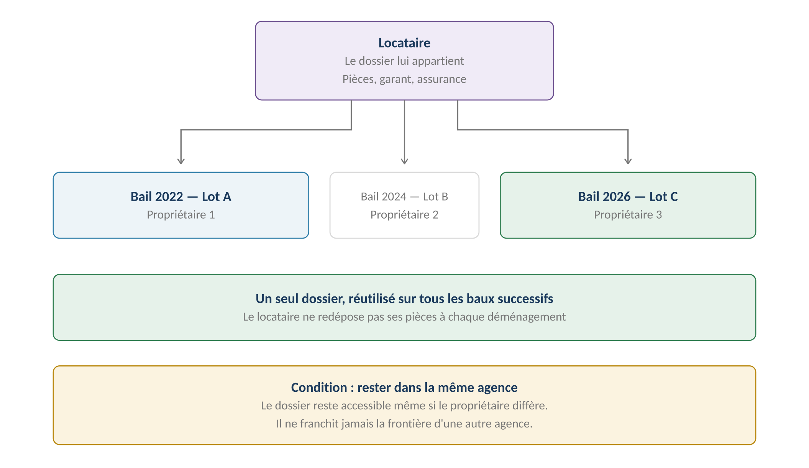

# Dossier locataire

**Définition :** l'ensemble des **pièces justificatives** d'un [[Locataire]] (et de son
garant), versionnées et datées. **Principe fondateur : le dossier appartient à la
personne, pas au bail** — un locataire qui change de lot dans la même agence garde son
dossier et ne redépose rien.
Source : [[2026-07-24-gerimmo-v3-module-0b-dossier-locataire|Module 0b]].

**Hors périmètre (acté)** : la prospection et la sélection du locataire — le module
commence quand le locataire est déjà retenu.

## Portée et accès

- Le dossier **suit la personne au sein de l'agence** (RM-0b.7.2), quel que soit le
  propriétaire du lot ; il ne franchit **jamais** une frontière d'agence (RM-0b.7.3 =
  RM-A1.10 — [[Compte, personne et adhésion]]).
- **Le propriétaire mandant ne voit aucune pièce** (RM-0b.7.4, bloquant) —
  « le mandant reçoit, il ne consulte pas » ([[Propriétaire bailleur]]).
- Trois portes d'accès : fiche personne (tout), fiche lot (locataire en place),
  fiche bail (locataire + garant). Toute consultation est **tracée** (RM-0b.7.5).

## Les pièces

| Catégorie | Déposant | Expire |
|---|---|---|
| Identité, titre de séjour | Agent | Oui (seuils d'alerte, RM-0b.6.5) |
| Revenus, fiscalité, domicile | Agent | Non |
| **Assurance habitation** | **Locataire** | **Oui — annuelle** |
| Sur demande du gérant | Locataire (RM-0b.2.5) | Non |

Une catégorie peut contenir plusieurs pièces (trois bulletins de salaire) ; formats
PDF/JPG/PNG, 10 Mo. **Un dossier incomplet n'empêche pas le [[Bail]]** — il alerte
(RM-0b.2.3).
*En production depuis le 25/11/2026 (lot T3, version `062296e2`) : ce qu'un bailleur peut demander à un candidat ou à
une caution est limité à la liste du décret n° 2015-1437 — voir § « En production depuis le 25/11/2026 ».*

## Versioning intégral

Toutes les versions sont conservées, aucune écrasée (RM-0b.4.1) ; seule la courante
s'affiche, l'historique reste consultable ; chaque version porte sa date et son
déposant. Usages : litige sur sinistre (quelle assurance couvrait à la date des
faits), contestation de congé, contrôle, retour arrière. Une version antérieure ne se
supprime pas individuellement (RM-0b.4.5). Voir [[Document]].

## Le garant

**Une personne à part entière** (RM-0b.3.1) : sa fiche, ses pièces, réutilisables pour
couvrir plusieurs locataires sans duplication (RM-0b.3.2). Le **lien de garantie est
porté par le bail** (RM-0b.3.3, confirmé par RM-2.2.1) : la fin du bail l'éteint sans
effacer la fiche. L'engagement s'active par l'acte de cautionnement signé (Yousign dans le référentiel ; Zoho Sign ou
papier dans l'application — [[Signature électronique]]) ;
garanties Visale/GLI sans garant personne : voir [[Garantie]] (module 2). En colocation, le garant doit être rattaché à
un locataire du bail pour que l'acte se prépare (en production depuis le 25/11/2026, [[Garantie]]).

## L'attestation d'assurance — cycle annuel critique

Obligation légale annuelle ; seul parcours où le locataire agit seul (dépôt depuis son
espace, RM-0b.5.1 ; un dépôt notifie l'agence).
*Texte fourni (loi de 1989, art. 7 g, [[Recueil des textes officiels (v6)]], non recontrôlé sur Légifrance) : le
locataire justifie de l'assurance « lors de la remise des clés puis, chaque année, à la demande du bailleur ».
L'attestation d'assurance ne figure pas parmi les pièces exigibles d'un candidat (décret n° 2015-1437, annexe I).*

| Seuil | Destinataire | Effet |
|---|---|---|
| **J-30** | Locataire | Rappel de renouvellement |
| **J-15** | Agence | Relance à effectuer |
| **J+0** | Agence | **Défaut d'assurance constaté** |
| **J+15** | Agence (hebdomadaire) | Motif possible de résiliation |

**Chaque alerte est horodatée et conservée comme preuve** (RM-0b.6.2) — le bailleur ne
peut invoquer le défaut d'assurance que s'il prouve avoir réclamé le document
([[Notification et valeur probante]]). Le défaut **alerte mais ne verrouille rien**
(RM-0b.6.4). Aucune alerte si le bail se termine avant l'échéance. Plus de six mois
sans attestation : alerte critique à l'admin agence. Seuils intégrés au module 14
([[Agenda et échéances]]).
*En production depuis le 25/11/2026 (lot T3) : le courrier de rappel d'assurance sépare les deux voies du texte
fourni — résiliation de plein droit, qui suppose une clause et « ne produit effet qu'un mois après un commandement demeuré infructueux » ;
ou assurance souscrite par le bailleur pour le compte du locataire un mois après une mise en demeure restée sans effet,
mise en demeure qui « vaut renoncement à la mise en œuvre de la clause ». À rapprocher du « motif possible de
résiliation » à J+15 du tableau ci-dessus (référentiel), qui ne dit rien de ces deux procédures.*

## Purge RGPD (parcours 0b.8 — V2, modèle conçu dès la V1)

**5 ans après la fin du dernier bail** dans l'agence (RM-0b.8.1), compteur relancé par
un nouveau bail. **Suspension automatique si procédure en cours** (impayé, contentieux —
RM-0b.8.3) ; blocage si la personne est encore garante (RM-0b.8.10) ; refus si bail
actif. Alerte agence à J-30 (prolongation possible, justifiée) → **corbeille 3 mois**
restaurable → suppression définitive, tracée au journal d'audit (**3 ans** — RM-A2.6).
**Purgé** : pièces d'identité, revenus, imposition, attestations (base légale
« contrat », bail + 5 ans — matrice A2 ; **supprimables sur demande même avant
terme**). **Conservés au-delà** : l'historique des baux, les quittances, les écritures
comptables (10 ans) — « sinon les rapports de gestion et les exercices passés seraient
cassés » (RM-0b.8.7).
**Correction A2** ([[2026-07-24-gerimmo-v3-a2-conservation-rgpd|livrable A2]]) : la
personne n'est plus « jamais supprimée » — identité et coordonnées sont
**anonymisées au terme de l'archivage** (bail + 5 ans), l'historique perdant son
caractère personnel (« Bail nº 1287, lot 47 »). Un contentieux gèle le cycle
(RM-A2.7). Déclenchable manuellement sur demande RGPD du locataire (RM-0b.8.9).
Voir [[RGPD]].

## État dans l'application au 23/11/2026 — pièces demandées avant le bail (mission palier 1, lot 33)
En préproduction le 23/11 ; en production depuis le 25/11/2026 dans la version `062296e2`, modifié par le lot T3 (voir
ci-dessous) ([[Mission palier 1 — audit du 22 novembre 2026]], point P0-04 ; détail dans `JOURNAL.md`).
- Le gestionnaire peut **demander** une pièce à une personne depuis sa fiche (onglet « Demander à la personne » du
  volet des justificatifs). Le bouton « RIB » n'y est plus proposé d'un clic, ni donné en exemple.
- Tant que la personne n'a pas de bail signé (candidat), un rappel s'affiche : les pièces qu'un bailleur peut demander à
  un candidat ou à sa caution sont encadrées par la réglementation ; vérifier la liste sur le site officiel de
  l'administration ; Gerimmo ne contrôle pas ce qui est demandé. Le libellé de la pièce reste **libre**.
- *Remplacé dans la version en production depuis le 25/11/2026 (lot T3) :* pour un candidat ou une caution, le libellé
  libre cède la place à la liste du décret — voir ci-dessous. Jusqu'au 25/11, la version `81740dec` n'avait ni ce rappel
  ni la liste.

> [!warning] Liste officielle des pièces non relue (23/11/2026)
> L'agent n'a pas pu ouvrir le texte qui fixe la liste des pièces exigibles (sites officiels inaccessibles depuis son
> environnement). Le rappel n'en cite aucune et ne bloque rien ; la question d'une liste fermée est posée au juriste
> (`JURISTE.md`, partie 1, point 36). Rien ici n'est présenté comme conforme.
> *25/11 : le décret n° 2015-1437 et ses deux annexes sont dans le recueil fourni (réf. 19, non recontrôlé sur
> Légifrance) ; la liste est fermée et le RIB n'y figure pas.*

## En production depuis le 25/11/2026 — pièces du décret n° 2015-1437 (lot T3 et sa reprise)

**Jusqu'au 25/11** (version du 21/11, `81740dec`) : rien de ce qui suit, ni le rappel du lot 33. **En production depuis
le 25/11/2026** à 23:17Z (26/11 à 00 h 17, heure de Paris) : lot T3 et sa reprise, dans la branche réunie
`claude/palier-1-fusion` (`89cb87ff`, complétée jusqu'à `062296e2`), vérifiée en entier sur le banc et poussée le 25/11
sur la branche de préproduction `claude/palier-1-preproduction` (`JOURNAL.md`, entrée du 25/11), puis publiée par la
PR #358 (`main` = `8f9dd9ce`, identique à `062296e2`) ; recette de production n° 58 réussie (`log.md`, entrée « deploy »
du 25/11). Référence : le [[Recueil des textes officiels (v6)]], **fourni par le dirigeant, non recontrôlé sur
Légifrance** (la publication n'y change rien).

- **Texte fourni** (décret n° 2015-1437, art. 1er) : la liste des pièces « pouvant être exigées par le bailleur de chacun
  des candidats à la location figure en annexe 1 », celle des cautions « en annexe 2 » ; « Les pièces produites peuvent
  être des copies des documents originaux » ; les originaux « doivent pouvoir être présentés à la demande du bailleur ».
- **Qui est concerné** : avant tout bail signé (**candidat**, annexe I) et pour une **caution** (annexe II), la pièce se
  choisit dans la liste du décret — 34 textes recopiés mot pour mot, vérifiés par programme ; le libellé libre est refusé
  par l'action serveur (pas par la base : un appel direct du gérant passerait, relecture T3R-3). Identité et domicile :
  une seule demande en cours par rubrique, candidat et caution distingués (« … (caution) ») ; une pièce déjà reçue
  (identité périmée, illisible) peut être redemandée.
- **Libellé libre gardé** pour le locataire d'un bail signé en cours, et rendu (reprise T3R-2) à qui n'est pas candidat :
  titulaire d'un bail signé terminé, colocataire parti d'un bail signé, détenteur d'un lot, mandant d'un mandat non
  résilié — à condition de n'être ni caution ni locataire d'un bail en préparation. La même lecture
  (`pieces-regime.ts`) sert à l'écran et au refus ; une lecture qui échoue refuse la demande.
- **Caution après la signature** : toujours limitée à l'annexe II, par prudence (Q113). Les demandes au nom libre faites
  avant le lot restent relançables ; rien n'est supprimé (Q114).
- **E-mail de demande** : il reproduit en entier le texte du décret joint à une pièce de la liste (sept textes
  dépassaient la coupe à 300 caractères) ; une précision libre reste abrégée.
- Ce qui ne s'y trouve plus avant le bail : le **RIB** (absent de l'annexe I) et l'attestation d'assurance (due à la
  remise des clés).

> [!warning] Points à trancher / contradictions (25/11/2026)
> - **Hors périmètre ou non ?** La définition ci-dessus dit le module 0b hors prospection et sélection du locataire
>   (« le locataire est déjà retenu ») ; la version en production depuis le 25/11 encadre pourtant les pièces demandées
>   à un **candidat**.
> - **Identité de la caution** (annexe II, A) : dans le recueil, la liste s'arrête au permis de conduire et finit par un
>   point-virgule, sans le document de séjour cité pour le candidat ; ligne sautée à l'extraction ? Gerimmo s'en tient
>   aux trois documents (`JURISTE.md`, partie 9, point 20).
> - **Caution après la signature** : la liste du décret s'applique-t-elle encore ? (`JURISTE.md`, partie 9, point 23).
> - **Ancien propriétaire (détention close, aucun mandat) ou ancienne caution sans autre lien** : ils retombent sur la
>   liste des candidats ; leur rendre le nom libre ? Redemander une identité sans motif : faut-il en exiger un ?
>   (`livrables/notes-banc/notes-T3.md`, reprise, § 4 et § 5).
> - **Article 22-2 de la loi de 1989** : version consultée en avril 2023 dans le recueil (Q111). Il interdit d'imposer
>   « la cosignature d'un ascendant ou d'un descendant du candidat à la location » : aucun rappel dans Gerimmo (noté,
>   non codé).

## Relations

Alimente le [[Bail]] (module 1) et les [[Garantie|garanties]] (module 2) ; s'appuie sur
[[Document]] (versioning, stockage) ; alerte via [[Agenda et échéances]] (module 14) ;
dépôt mobile (module 19).
