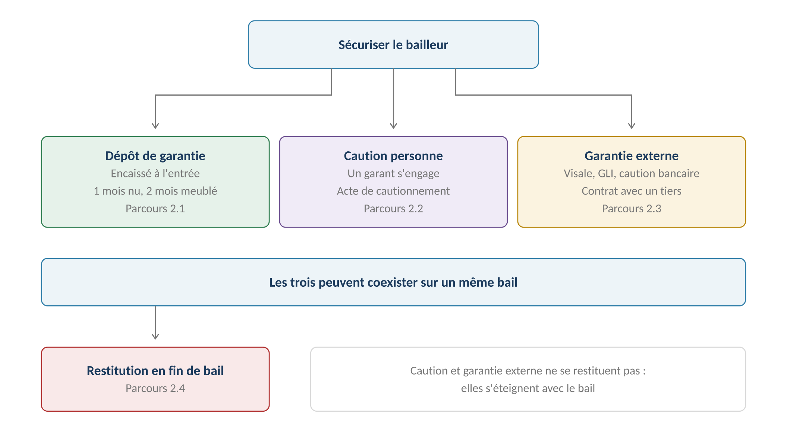

# Garantie

**Définition :** engagement d'un tiers qui sécurise le bailleur contre les impayés du
[[Locataire]] — caution personne physique ou dispositif externe (Visale, GLI, caution
bancaire, garantie employeur). Rattachée au [[Bail]] ; contrairement au
[[Dépôt de garantie]], une garantie **ne se restitue pas : elle s'éteint avec le bail**.
Source : [[2026-07-24-gerimmo-v3-module-2-garanties|Module 2]], parcours 2.2 / 2.3.

## Caution personne physique (2.2)

Le garant est **une personne à part entière** du [[Dossier locataire|module 0b]]
(RM-0b.3.1) — fiche et pièces réutilisables — mais **son engagement est rattaché à un
bail précis, jamais à une personne en général** (RM-2.2.1 = RM-0b.3.3). Un même garant
peut couvrir deux locataires sur deux baux : deux engagements séparés.

| Type | Portée | Usage |
|---|---|---|
| Caution simple | Le bailleur poursuit d'abord le locataire | Rare |
| **Caution solidaire** | **Le bailleur peut poursuivre directement le garant** | **Cas majoritaire — type par défaut** (RM-2.2.2) |

**Circuit d'activation** : sélection du garant parmi les personnes → type (simple /
solidaire) → durée de l'engagement → **case « aucune autre garantie »** (depuis le 24/10)
→ génération de l'acte de cautionnement (PDF) → **signature électronique dans Gerimmo,
chez Zoho Sign** (Yousign dans le référentiel, RM-2.2.6, remplacé le 18/10/2026), **après
que la caution a confirmé elle-même son numéro de mobile**, ou signature sur papier →
**l'acte signé conditionne l'activation de la garantie** (RM-2.2.3). Preuve : PDF signé et
certificat commun de Zoho Sign ([[Notification et valeur probante]], famille 2).
L'engagement de caution résulte **du seul acte de cautionnement, distinct et annexé au
bail**, reproduisant loyer, révision et durée de l'engagement
([[2026-08-05-bailpdf-contrat-de-bail|BailPDF]]). **Dans Gerimmo, le garant signe aussi le
bail**, mais seulement pour reconnaître en avoir reçu un exemplaire : le cadre « La
caution » du bail dit « Reconnaît avoir reçu un exemplaire du présent contrat. Son
engagement de caution résulte du seul acte de cautionnement signé séparément. » (au
pluriel avec plusieurs garants), et sa page de signature électronique : « En signant cette
page, la caution reconnaît avoir reçu un exemplaire du présent contrat. Elle ne s'engage
comme caution que par l'acte de cautionnement signé séparément. »

## Signature du cautionnement dans Gerimmo (en production depuis le 24/10/2026)
Décision du dirigeant du 23/10 (« le cautionnement et l'état des lieux doivent etre signé
sur gerimmo directement ! ») ; PR #246.
- **Case avant de générer l'acte** : « Je certifie n'avoir souscrit aucune assurance ni
  aucune autre garantie couvrant les obligations locatives de ce locataire (par exemple une
  assurance loyers impayés), ou louer ce logement à un étudiant ou à un apprenti. À défaut,
  le cautionnement serait nul (article 22-1 de la loi du 6 juillet 1989). » Sans elle :
  « Confirmez l'absence d'assurance loyers impayés ou d'autre garantie avant de préparer
  l'acte. »
- **La caution confirme son mobile** : « Envoyer » adresse à la caution un lien à usage
  unique (sept jours au plus) ; elle y saisit deux fois son numéro, jamais prérempli ;
  l'adresse et le numéro d'une autre partie (bailleur, détenteur du lot, gestionnaire,
  organisation) sont refusés ; cinq liens par caution et par bail en 24 h ; le bailleur voit
  « En attente de la caution » et peut renvoyer le lien. Une garde en base refuse tout envoi
  d'un acte dont le téléphone n'est pas celui que la caution a confirmé ; une fois parti, ce
  numéro ne change plus. La caution saisit elle-même sa mention dans sa session de
  signature ; le service refuse une mention incomplète ou différente.
- **Garant du bail aligné le 24/10** (choix délégué n° 1) : le garant qui signe aussi le
  bail confirme lui-même son mobile par le même chemin ; le numéro confirmé pour l'acte de
  cautionnement du même bail est repris sans nouvelle demande ; jamais le numéro saisi par
  le bailleur.
- **Modèle** : la date de l'acte est « date effective à compléter lors de la signature » ;
  l'acte est fait « en autant d'exemplaires originaux que de parties ou, en cas de signature
  électronique, sous forme d'un exemplaire électronique remis à chacune d'elles ; un
  exemplaire du contrat de location est remis à la caution ».

**En colocation** : chaque garant couvre **un colocataire identifié** (RM-2.2.4 =
RM-1.3.8), jamais le bail en bloc ; **son engagement s'éteint avec la solidarité du
colocataire qu'il couvre** (RM-2.2.5, US-2.2.1) — extinction calculée et tracée au
module 1. Depuis l'audit des parcours métier du 29/09 : au départ du colocataire, le garant **reste
rattaché au bail** (il n'est plus supprimé) et sa fin d'engagement est fixée à la fin de
solidarité du colocataire — six mois après la date d'effet de son congé, ou cette date
s'il est remplacé par un nouveau colocataire au bail (art. 8-1).

**Cautionnement sans durée — faculté de résiliation** (art. 22-1, avant-dernier
alinéa). L'acte généré par Gerimmo engage la caution « pour la durée du bail et de ses
renouvellements », sans durée déterminée : il reproduit donc le texte légal —
« Lorsque le cautionnement d'obligations résultant d'un contrat de location conclu en
application du présent titre ne comporte aucune indication de durée ou lorsque la
durée du cautionnement est stipulée indéterminée, la caution peut le résilier
unilatéralement. La résiliation prend effet au terme du contrat de location, qu'il
s'agisse du contrat initial ou d'un contrat reconduit ou renouvelé, au cours duquel le
bailleur reçoit notification de la résiliation. »

## Garanties externes (2.3)

| Dispositif | Nature | Ce que Gerimmo enregistre |
|---|---|---|
| **Visale** | Garantie gratuite d'Action Logement | Numéro de visa, période, plafond |
| **GLI** | Assurance loyers impayés souscrite par le bailleur | Assureur, contrat, franchise |
| **Caution bancaire** | Engagement d'une banque | Banque, montant, durée |
| **Garantie employeur** | Engagement d'un employeur | Entreprise, référence |

- **Aucune intégration avec les organismes** (RM-2.3.1, décision actée — intégrations
  hors périmètre) : Gerimmo enregistre l'existence et les caractéristiques ; pas de
  vérification en ligne auprès d'Action Logement, pas de déclaration de sinistre GLI.
- **Plusieurs garanties peuvent coexister** sur un même bail (RM-2.3.2).
- **Visale peut se substituer au dépôt de garantie**, qui reste alors à zéro (RM-2.3.3).

## Relations

- Portée par le [[Bail]] (onglet Garanties) ; garant issu du [[Dossier locataire]]
  (la purge RGPD est bloquée tant qu'une personne est garante, RM-0b.8.10).
- Acte de cautionnement signé via le module 13 ([[Notification et valeur probante]]).
- Échéance de garantie alertée par le module 14 ([[Agenda et échéances]]).
- En cas d'impayé, la mise en jeu de la garantie (relance du garant, sinistre GLI)
  s'opère **hors application** — voir [[Relances et mise en demeure]].

> [!note] Étendue de l'engagement du garant en colocation — décision (humain, 2026-08-01)
> Suit **la loi et la pratique** (arbitrage du garant, ingest [[2026-08-01-bailpdf-com]]) :
> le garant est **rattaché à un colocataire nommé** (acte de cautionnement nominatif,
> RM-1.3.8) ; si l'acte porte une **clause de solidarité**, le bailleur peut le
> solliciter **au-delà de la part** de son colocataire (jusqu'au total) ; mais la **loi
> ALUR plafonne** son engagement pour un colocataire **partant à 6 mois** après le
> départ (ou dès l'acceptation d'un remplaçant). À stocker sur la garantie : **nature**
> (simple / solidaire) et **durée** (déterminée / indéterminée). Le texte de la mention
> légale doit suivre la **réforme 2022** (ordonnance 2021-1192), pas l'ancien « lu et
> approuvé ». Voir [[Documents a generer et automatisation WhatsApp]].

> [!warning] Points à trancher / contradictions (14/10/2026)
> - **Pluralité des garanties (RM-2.3.2)** : « plusieurs garanties peuvent coexister sur un même bail » contredit, d'après les sources lues, l'article 22-1 de la loi du 6 juillet 1989 (pas de cautionnement quand une assurance ou une autre garantie couvre les obligations locatives, sauf locataire étudiant ou apprenti) et la règle de non-cumul de Visale avec une assurance loyers impayés. Sources et réserves : [[Choisir son locataire selon les conditions des assurances loyers impayés]] (brouillon : textes non relus sur leur version en vigueur).
>   **24/10 — en partie traité** : l'acte de cautionnement ne se génère plus sans la case « aucune assurance ni aucune autre garantie… ou louer ce logement à un étudiant ou à un apprenti » (option `sans_garantie_cumulee`, refus dans `assemblerCautionnement`) ; l'enregistrement de plusieurs garanties externes sur un même bail reste possible. Règle de l'article 22-1 et nullité : à confirmer sur Légifrance (source non ouverte le 23/10/2026).
> - **24/10 — cautionnement signé par code SMS** : valeur probante et formule exacte de la mention (C. civ. 2297, « ou l'une des autres cautions » ?) — à confirmer sur Légifrance (source non ouverte le 23/10/2026) ; cautionnement demandé par un bailleur personne morale autre qu'une SCI familiale (loi 89-462 art. 22-1) non vérifié.
> - **24/10 — remise de l'exemplaire signé à la caution** avec la copie du bail : recette Zoho réelle à faire.
> - **Visale et dépôt de garantie (RM-2.3.3)** : « Visale peut se substituer au dépôt de garantie » est à nuancer d'après la même synthèse ; à confirmer sur la page officielle de Visale avant toute évolution de l'écran.

## Relecture avant publication du 24 octobre

Voir [[Relecture adverse et publication conformité V1 — 24 octobre 2026]] pour les sources officielles consultées, les corrections retenues et les réserves encore ouvertes. Les mentions « non publié » ci-dessus décrivent l’état avant la mise en ligne ; seule une entrée `deploy` du journal en atteste l’achèvement.
