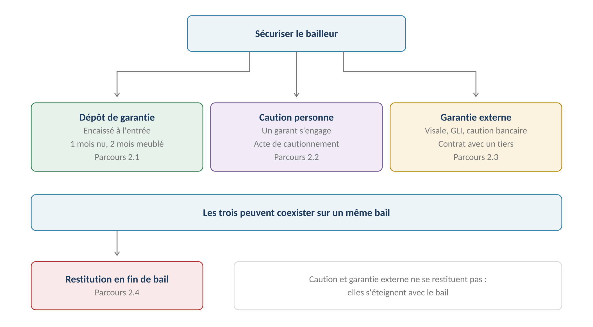

# Garantie

**Définition :** engagement d'un tiers qui sécurise le bailleur contre les impayés du
[[Locataire]] — caution personne physique ou dispositif externe (Visale, GLI, caution
bancaire, garantie employeur). Rattachée au [[Bail]] ; contrairement au
[[Dépôt de garantie]], une garantie **ne se restitue pas : elle s'éteint avec le bail**.
Source : [[2026-07-24-gerimmo-v3-module-2-garanties|Module 2]], parcours 2.2 / 2.3.

## Caution personne physique (2.2)

Le garant est **une personne à part entière** du [[Dossier locataire|module 0b]]
(RM-0b.3.1) — fiche et pièces réutilisables — mais **son engagement est rattaché à un
bail précis, jamais à une personne en général** (RM-2.2.1 = RM-0b.3.3). Un même garant
peut couvrir deux locataires sur deux baux : deux engagements séparés.

| Type | Portée | Usage |
|---|---|---|
| Caution simple | Le bailleur poursuit d'abord le locataire | Rare |
| **Caution solidaire** | **Le bailleur peut poursuivre directement le garant** | **Cas majoritaire — type par défaut** (RM-2.2.2) |

**Circuit d'activation** : sélection du garant parmi les personnes → type (simple /
solidaire) → durée de l'engagement → **case « aucune autre garantie »** (depuis le 24/10)
→ génération de l'acte de cautionnement (PDF) → **signature électronique dans Gerimmo,
chez Zoho Sign** (Yousign dans le référentiel, RM-2.2.6, remplacé le 18/10/2026), **après
que la caution a confirmé elle-même son numéro de mobile**, ou signature sur papier →
**l'acte signé conditionne l'activation de la garantie** (RM-2.2.3). Preuve : PDF signé et
certificat commun de Zoho Sign ([[Notification et valeur probante]], famille 2).
*Version préparée (lot T2, non publiée) : deux refus de plus avant de générer l'acte — bailleur société hors SCI
familiale, et garant non rattaché à un colocataire sur un bail à plusieurs locataires ; voir § « Version préparée ».*
L'engagement de caution résulte **du seul acte de cautionnement, distinct et annexé au
bail**, reproduisant loyer, révision et durée de l'engagement
([[2026-08-05-bailpdf-contrat-de-bail|BailPDF]]). **Dans Gerimmo, le garant signe aussi le
bail**, mais seulement pour reconnaître en avoir reçu un exemplaire : le cadre « La
caution » du bail dit « Reconnaît avoir reçu un exemplaire du présent contrat. Son
engagement de caution résulte du seul acte de cautionnement signé séparément. » (au
pluriel avec plusieurs garants), et sa page de signature électronique : « En signant cette
page, la caution reconnaît avoir reçu un exemplaire du présent contrat. Elle ne s'engage
comme caution que par l'acte de cautionnement signé séparément. »

## Signature du cautionnement dans Gerimmo (en production depuis le 24/10/2026)
Décision du dirigeant du 23/10 (« le cautionnement et l'état des lieux doivent etre signé
sur gerimmo directement ! ») ; PR #246.
- **Case avant de générer l'acte** : « Je certifie n'avoir souscrit aucune assurance ni
  aucune autre garantie couvrant les obligations locatives de ce locataire (par exemple une
  assurance loyers impayés), ou louer ce logement à un étudiant ou à un apprenti. À défaut,
  le cautionnement serait nul (article 22-1 de la loi du 6 juillet 1989). » Sans elle :
  « Confirmez l'absence d'assurance loyers impayés ou d'autre garantie avant de préparer
  l'acte. »
- **La caution confirme son mobile** : « Envoyer » adresse à la caution un lien à usage
  unique (sept jours au plus) ; elle y saisit deux fois son numéro, jamais prérempli ;
  l'adresse et le numéro d'une autre partie (bailleur, détenteur du lot, gestionnaire,
  organisation) sont refusés ; cinq liens par caution et par bail en 24 h ; le bailleur voit
  « En attente de la caution » et peut renvoyer le lien. Une garde en base refuse tout envoi
  d'un acte dont le téléphone n'est pas celui que la caution a confirmé ; une fois parti, ce
  numéro ne change plus. La caution saisit elle-même sa mention dans sa session de
  signature ; le service refuse une mention incomplète ou différente.
- **Garant du bail aligné le 24/10** (choix délégué n° 1) : le garant qui signe aussi le
  bail confirme lui-même son mobile par le même chemin ; le numéro confirmé pour l'acte de
  cautionnement du même bail est repris sans nouvelle demande ; jamais le numéro saisi par
  le bailleur.
- **Modèle** : la date de l'acte est « date effective à compléter lors de la signature » ;
  l'acte est fait « en autant d'exemplaires originaux que de parties ou, en cas de signature
  électronique, sous forme d'un exemplaire électronique remis à chacune d'elles ; un
  exemplaire du contrat de location est remis à la caution ».

**En colocation** : chaque garant couvre **un colocataire identifié** (RM-2.2.4 =
RM-1.3.8), jamais le bail en bloc ; **son engagement s'éteint avec la solidarité du
colocataire qu'il couvre** (RM-2.2.5, US-2.2.1) — extinction calculée et tracée au
module 1. Depuis l'audit des parcours métier du 29/09 : au départ du colocataire, le garant **reste
rattaché au bail** (il n'est plus supprimé) et sa fin d'engagement est fixée à la fin de
solidarité du colocataire — six mois après la date d'effet de son congé, ou cette date
s'il est remplacé par un nouveau colocataire au bail (art. 8-1). *Version préparée : pour un bail coché « mariés ou
pacsés », le garant de l'époux ou partenaire parti n'a plus de date de fin ([[Bail]]).*

**Cautionnement sans durée — faculté de résiliation** (art. 22-1, avant-dernier
alinéa). L'acte généré par Gerimmo engage la caution « pour la durée du bail et de ses
renouvellements », sans durée déterminée : il reproduit donc le texte légal —
« Lorsque le cautionnement d'obligations résultant d'un contrat de location conclu en
application du présent titre ne comporte aucune indication de durée ou lorsque la
durée du cautionnement est stipulée indéterminée, la caution peut le résilier
unilatéralement. La résiliation prend effet au terme du contrat de location, qu'il
s'agisse du contrat initial ou d'un contrat reconduit ou renouvelé, au cours duquel le
bailleur reçoit notification de la résiliation. »

## Garanties externes (2.3)

| Dispositif | Nature | Ce que Gerimmo enregistre |
|---|---|---|
| **Visale** | Garantie gratuite d'Action Logement | Numéro de visa, période, plafond |
| **GLI** | Assurance loyers impayés souscrite par le bailleur | Assureur, contrat, franchise |
| **Caution bancaire** | Engagement d'une banque | Banque, montant, durée |
| **Garantie employeur** | Engagement d'un employeur | Entreprise, référence |

- **Aucune intégration avec les organismes** (RM-2.3.1, décision actée — intégrations
  hors périmètre) : Gerimmo enregistre l'existence et les caractéristiques ; pas de
  vérification en ligne auprès d'Action Logement, pas de déclaration de sinistre GLI.
- **Plusieurs garanties peuvent coexister** sur un même bail (RM-2.3.2).
- **Visale peut se substituer au dépôt de garantie**, qui reste alors à zéro (RM-2.3.3).

## État dans l'application au 23/11/2026 — bailleur en société (mission palier 1, lot 33)
En préproduction, **non publié** ([[Mission palier 1 — audit du 22 novembre 2026]], point P0-09).
- Sur la carte « Cautionnement » du bail, un rappel s'affiche : « Bailleur en société (SCI, autre personne morale) :
  demander une caution n'est pas permis dans tous les cas. Vérifiez votre situation (ADIL, juriste) avant de faire
  signer cet acte ; Gerimmo ne contrôle pas ce point. »
- L'acte reste proposé : Gerimmo ne refuse pas de le préparer, faute d'avoir pu relire le texte qui fixe les cas.
- *Remplacé dans la version préparée (lot T2, 25/11) :* le rappel « Gerimmo ne contrôle pas ce point » laisse place à un
  refus, d'après le texte fourni — voir § « Version préparée ». En production aujourd'hui, ni le rappel ni le refus.

> [!warning] Cas où la caution est interdite : non tranché (23/11/2026)
> L'agent n'a pas pu relire le texte. Dans quels cas précis Gerimmo doit-il refuser de préparer l'acte ? Question au
> juriste (`JURISTE.md`, partie 1, point 39).
> *25/11 : le texte est dans le recueil fourni (art. 22-1, non recontrôlé sur Légifrance) ; le refus est codé dans la
> version préparée. Restent au juriste : déclaration « étudiant non boursier » sans justificatif, apprenti, indivision
> comprenant une société (`JURISTE.md`, partie 9, points 13 et 14).*

## Relations

- Portée par le [[Bail]] (onglet Garanties) ; garant issu du [[Dossier locataire]]
  (la purge RGPD est bloquée tant qu'une personne est garante, RM-0b.8.10).
- Acte de cautionnement signé via le module 13 ([[Notification et valeur probante]]).
- Échéance de garantie alertée par le module 14 ([[Agenda et échéances]]).
- En cas d'impayé, la mise en jeu de la garantie (relance du garant, sinistre GLI)
  s'opère **hors application** — voir [[Relances et mise en demeure]].

> [!note] Étendue de l'engagement du garant en colocation — décision (humain, 2026-08-01)
> Suit **la loi et la pratique** (arbitrage du garant, ingest [[2026-08-01-bailpdf-com]]) :
> le garant est **rattaché à un colocataire nommé** (acte de cautionnement nominatif,
> RM-1.3.8) ; si l'acte porte une **clause de solidarité**, le bailleur peut le
> solliciter **au-delà de la part** de son colocataire (jusqu'au total) ; mais la **loi
> ALUR plafonne** son engagement pour un colocataire **partant à 6 mois** après le
> départ (ou dès l'acceptation d'un remplaçant). À stocker sur la garantie : **nature**
> (simple / solidaire) et **durée** (déterminée / indéterminée). Le texte de la mention
> légale doit suivre la **réforme 2022** (ordonnance 2021-1192), pas l'ancien « lu et
> approuvé ». Voir [[Documents a generer et automatisation WhatsApp]].

> [!warning] Points à trancher / contradictions (14/10/2026)
> - **Pluralité des garanties (RM-2.3.2)** : « plusieurs garanties peuvent coexister sur un même bail » contredit, d'après les sources lues, l'article 22-1 de la loi du 6 juillet 1989 (pas de cautionnement quand une assurance ou une autre garantie couvre les obligations locatives, sauf locataire étudiant ou apprenti) et la règle de non-cumul de Visale avec une assurance loyers impayés. Sources et réserves : [[Choisir son locataire selon les conditions des assurances loyers impayés]] (brouillon : textes non relus sur leur version en vigueur).
>   **24/10 — en partie traité** : l'acte de cautionnement ne se génère plus sans la case « aucune assurance ni aucune autre garantie… ou louer ce logement à un étudiant ou à un apprenti » (option `sans_garantie_cumulee`, refus dans `assemblerCautionnement`) ; l'enregistrement de plusieurs garanties externes sur un même bail reste possible. Règle de l'article 22-1 et nullité : à confirmer sur Légifrance (source non ouverte le 23/10/2026).
> - **24/10 — cautionnement signé par code SMS** : valeur probante et formule exacte de la mention (C. civ. 2297, « ou l'une des autres cautions » ?) — à confirmer sur Légifrance (source non ouverte le 23/10/2026) ; cautionnement demandé par un bailleur personne morale autre qu'une SCI familiale (loi 89-462 art. 22-1) non vérifié.
> - **24/10 — remise de l'exemplaire signé à la caution** avec la copie du bail : recette Zoho réelle à faire.
> - **Visale et dépôt de garantie (RM-2.3.3)** : « Visale peut se substituer au dépôt de garantie » est à nuancer d'après la même synthèse ; à confirmer sur la page officielle de Visale avant toute évolution de l'écran.
> - *25/11 — lecture du [[Recueil des textes officiels (v6)|recueil]] (texte fourni, non recontrôlé sur Légifrance) :*
>   l'article 22-1 fourni interdit le cautionnement quand une assurance ou une autre garantie couvre les obligations
>   locatives, « sauf en cas de logement loué à un étudiant ou un apprenti » : la case de l'acte suit ce texte ;
>   l'enregistrement de plusieurs garanties externes reste possible (non tranché). L'avant-dernier alinéa reproduit dans
>   l'acte (résiliation d'un cautionnement sans durée) est identique au texte fourni. La remise d'un exemplaire du bail à
>   la caution y est prescrite « à peine de nullité du cautionnement » ; l'acte la prévoit. La mention recopiée contient
>   les éléments de l'article 2297 fourni ; reste la saisie au clavier en signature électronique (« appose elle-même »).
>   Le bailleur personne morale autre qu'une SCI familiale : voir § « Version préparée ». Rien de cela n'est présenté
>   comme conforme (`livrables/recueil/analyse-refs-01-09.md`, réf. 03 et 04).

## Relecture avant publication du 24 octobre

Voir [[Relecture adverse et publication conformité V1 — 24 octobre 2026]] pour les sources officielles consultées, les corrections retenues et les réserves encore ouvertes. Les mentions « non publié » ci-dessus décrivent l’état avant la mise en ligne ; seule une entrée `deploy` du journal en atteste l’achèvement.

## Version préparée, à publier — acte de cautionnement relu sur le texte fourni (au 25/11/2026)

**En production aujourd'hui** (version du 21/11, `81740dec`) : l'acte se prépare comme décrit plus haut (case « aucune
autre garantie », mobile confirmé par la caution), sans les refus ci-dessous. **Version préparée** : lots T2 et T3, case
« mariés ou pacsés », réunis dans la branche `claude/palier-1-fusion` (`89cb87ff`, complétée par `ee28d874`), vérifiée en entier sur le banc et
poussée le 25/11 sur la branche de préproduction `claude/palier-1-preproduction` (`JOURNAL.md`, entrée du 25/11) ; non
publiée en production. Référence : le [[Recueil des textes officiels (v6)]], **fourni par le dirigeant, non
recontrôlé sur Légifrance**.

- **Bailleur société.** Texte fourni (art. 22-1) : « Si le bailleur est une personne morale autre qu'une société civile
  constituée exclusivement entre parents et alliés jusqu'au quatrième degré inclus, le cautionnement ne peut être
  demandé que : - s'il est apporté par un des organismes dont la liste est fixée par décret en Conseil d'Etat ; - ou si
  le logement est loué à un étudiant ne bénéficiant pas d'une bourse de l'enseignement supérieur. » L'acte est
  **refusé** quand un bailleur a la qualité « SCI » (non familiale) ou « Personne morale », sauf si la case « logement
  loué à un étudiant qui ne bénéficie pas d'une bourse » est cochée (carte du bail, catalogue, signature en ligne) ; la
  déclaration s'imprime dans l'acte. SCI familiale, personne physique, indivision de personnes physiques : inchangé ;
  indivision comprenant une société : refus. La caution d'un organisme habilité ne se prépare pas (liste du décret
  absente du recueil). Qualité du bailleur absente ou illisible : traitée comme une personne physique (refus
  contournable, relecture T2R-5).
- **Colocation.** Texte fourni (art. 8-1) : l'acte « identifie nécessairement, sous peine de nullité, le colocataire
  pour lequel l'extinction de la solidarité met fin à l'engagement de la caution ». Sur un bail à plusieurs locataires,
  l'acte est **refusé tant que le garant n'est pas rattaché à un locataire du bail** ; un même garant ne peut pas être
  rattaché aux deux époux (caution commune impossible, T2R-4).
- **Contenu** : date de révision et valeur de l'indice reprises comme au bail ; plus de « pénalités de retard » (ni dans
  l'acte, ni dans la mention à recopier) ; fin de la solidarité dans l'ordre de l'article 8-1 VI, suivie de l'exception
  des époux et partenaires de PACS (phrase conditionnelle). L'acte **n'est pas adapté** à la case « mariés ou pacsés »
  (question au dirigeant, `livrables/notes-banc/notes-mariage.md`, § 5).
- **Case « mariés ou pacsés » cochée** : au départ de l'un des époux ou partenaires présents à la signature, sa caution
  n'a pas de date de fin ; relances et information de la caution continuent. Un tiers entré après la signature et son
  garant suivent la règle de la colocation ([[Bail]]).
- **Information de la caution d'un impayé.** Texte fourni (code civil, art. 2303) : le créancier professionnel informe
  la caution personne physique « dès le premier incident de paiement non régularisé dans le mois de l'exigibilité de ce
  paiement ». Gerimmo informe la caution à la **seconde relance**, réglable jusqu'à 90 jours (15 par défaut). Version
  préparée : avertissement seulement — les loyers d'un bail avec caution affichent la date à ne pas dépasser (échéance +
  un mois) et ce que Gerimmo ne fait pas ; le réglage des relances le dit aussi (Q112). L'envoi automatique est fermé à
  la livraison ; décision du 24/11 : l'ouvrir le jour de la publication (Q6). La **relance à la main** ouverte par la
  décision Q24 ne part jamais à la caution ([[Relances et mise en demeure]]).
- **Pièces demandées à une caution** : liste du décret n° 2015-1437, annexe II, y compris après la signature
  ([[Dossier locataire]], Q113).
- **Circuits « prêts »** : un acte de cautionnement préparé mais pas encore envoyé — y compris celui qui attend que la
  caution confirme son mobile — est refusé à l'envoi et se prépare de nouveau (Q40) ; contrôle de production du 24/11 :
  aucun circuit concerné, à refaire avant la publication.

> [!warning] Points à trancher / contradictions (25/11/2026)
> - **Déclaration « étudiant non boursier »** : simple déclaration du bailleur, sans justificatif ni lien avec le type de
>   bail ; apprenti non cité par le texte fourni pour ce cas ; indivision avec une société refusée — trop sévère ?
>   (`JURISTE.md`, partie 9, points 13 et 14).
> - **Époux colocataires** : acte qui désigne un seul des deux sous une règle conditionnelle ; caution commune aux deux ;
>   durée de l'engagement de la caution d'un époux quand l'article 8-1 VI ne s'applique pas (`JURISTE.md`, partie 9,
>   points 12 et 40 ; `livrables/notes-banc/notes-mariage.md`, § 6). Garant d'un tiers entré au bail après la signature,
>   bail signé de nouveau après « Corriger » : `JURISTE.md`, partie 9, point 41 ; `QUESTIONS.md`, Q116 et Q122.
> - **Article 2303** : « dans le mois de l'exigibilité » est-il le délai d'information ? Un bailleur particulier, ou une
>   agence qui gère pour lui, est-il un « créancier professionnel » ? Un e-mail simple suffit-il ? (`JURISTE.md`,
>   partie 9, points 21 et 22). Faut-il avancer la seconde relance à 30 jours quand le bail a une caution ? (Q112).
> - **Note du 01/08 ci-dessus** : « si l'acte porte une clause de solidarité, le bailleur peut le solliciter au-delà de
>   la part de son colocataire » ; le texte fourni impose seulement que l'acte nomme le colocataire couvert — la portée
>   au-delà de sa part n'est pas tranchée par le recueil.
