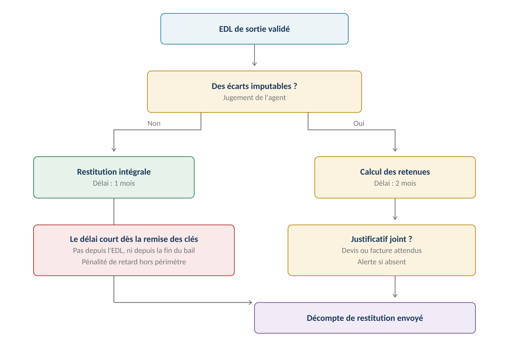

# Restitution du dépôt de garantie

**Le parcours le plus exposé du module 2 — criticité MAXIMALE, délai légal sanctionné.**
À la fin du [[Bail]], l'agent restitue le [[Dépôt de garantie]] au [[Locataire]],
déduction faite des impayés et des retenues justifiées par le comparatif d'
[[État des lieux]], après décote de [[Vétusté et décote|vétusté]].
Source : [[2026-07-24-gerimmo-v3-module-2-garanties|Module 2]], parcours 2.4 / 2.5 / 2.7.

## Le délai légal

- **Le délai court à compter de la remise des clés** (RM-2.4.1), non de l'état des lieux.
- **1 mois** si l'EDL de sortie est conforme à l'entrée, **2 mois** en cas d'écarts
  (RM-2.4.2). Alerte avant l'échéance (US-2.4.4, module 14 — [[Agenda et échéances]]).
- Délai dépassé : alerte ; la **pénalité de retard de 10 % par mois est hors périmètre
  V1** (RM-2.4.10). Délais 1/2 mois depuis la remise des clés et majoration de retard
  confirmés par [[2026-08-05-bailpdf-contrat-de-bail|BailPDF]] (qui confirme aussi :
  chaque retenue justifiée par devis/facture, vétusté normale jamais imputable).
- *Texte fourni (25/11)* : l'article 22 du [[Recueil des textes officiels (v6)]] (réf. 11, non recontrôlé sur
  Légifrance) donne les mêmes délais (un mois « lorsque l'état des lieux de sortie est conforme à l'état des lieux
  d'entrée », deux mois sinon, depuis la remise des clés), des retenues « dûment justifiées », et la majoration de 10 %
  du loyer mensuel en principal « pour chaque période mensuelle commencée en retard ». Le décompte de Gerimmo imprime
  ces règles ; il ne calcule pas la majoration. Le texte ne prévoit aucune suspension du délai.

## Le circuit (parcours nominal 2.4)

1. L'agent enregistre la **remise des clés** → le système lance le compteur (1 ou 2 mois).
2. Le système **reprend les écarts du comparatif d'EDL** (1.13).
3. L'agent **juge l'imputabilité de chaque écart** (« le module 1 constate, il ne juge
   pas ») et saisit le coût de remise en état.
4. Le système **applique la décote de vétusté** depuis la grille ([[Vétusté et décote]]).
5. L'agent joint devis ou facture (**alerte si absent**, RM-2.4.6 — retenue acceptée
   mais « difficilement défendable », absence tracée, US-2.4.2). *Version préparée (Q49) : sans pièce, aucun des deux
   décomptes ne se produit — voir la section du 25/11.*
6. Le système calcule le solde ; l'agent valide et **génère le décompte** (PDF), envoyé
   au locataire (2.7).

## Règles d'imputation

- **Sans EDL d'entrée : retenues possibles, mais uniquement justifiées** (corrigé le
  29/09/2026). À défaut d'état des lieux, le locataire est **présumé avoir reçu le
  logement en bon état de réparations locatives** (art. 1731 du Code civil), sauf
  preuve contraire — présomption que le bailleur **ne peut pas invoquer s'il a fait
  obstacle** à l'établissement de l'EDL (art. 3-2 loi 89-462). L'application refuse une
  retenue **sans justificatif** (devis, facture, constat) et le décompte porte la mention
  « sans EDL d'entrée » avec ce rappel. Voir l'avertissement en fin de page.
- **Les impayés (loyers, charges) s'imputent sur le dépôt AVANT les retenues de
  dégradation** (RM-2.4.7).
- **Provision de 20 % maximum** conservable si une régularisation de charges est en
  attente, jusqu'à l'arrêté des comptes (RM-2.4.8). *Gerimmo ne propose pas cette
  provision (aucune occurrence dans le code, selon l'analyse du recueil) ; le texte fourni
  (art. 22) la permet dans un immeuble collectif, « dûment justifiée », sans clause au bail.*
- Retenues > dépôt : autorisé — **le solde bascule en créance** sur le locataire
  (module 3).
- **Colocation** : restitution unique, aux colocataires conjointement.
- Jamais retenu : usure normale, élément amorti (blocage), vétusté antérieure au bail —
  voir [[Vétusté et décote]]. Réparation locative non faite : retenue possible
  (décret 87-712).

## Le décompte (2.7)

Envoyé au locataire (email + espace) ; il détaille **chaque retenue : élément, coût,
âge, décote appliquée, montant retenu** (RM-2.7.1), les impayés imputés période par
période, la provision sur charges éventuelle, le solde restitué avec sa date. Les
**justificatifs joints sont accessibles au locataire** (RM-2.7.2, US-2.7.1).
**Le décompte est figé après envoi** — toute correction produit un **décompte
rectificatif** (RM-2.7.3). Le locataire ne voit **aucune retenue avant l'arrêté du
décompte** (RM-2.6.2, [[Dépôt de garantie]]).

## Litige sur retenue (2.5) — reporté en V2

En V1, la contestation passe par la **messagerie (module 15)** et le traçage
documentaire ; issue = nouveau décompte rectificatif. La V2 apporterait un objet litige
structuré (contestation datée, pièces rattachées, issue tracée). La **commission de
conciliation reste hors périmètre** dans les deux cas.

## Relations

Consomme : écarts du comparatif d'[[État des lieux]] (1.13), grille de
[[Vétusté et décote]] (paramétrée au module 18), impayés du module 3.
Alimente : **solde de tout compte (3.11)**, [[Comptabilité]] (écriture de restitution,
4.1). Alertes de délai au module 14 ([[Agenda et échéances]]).

## Canal du décompte — tranché (humain, 2026-07-25)

Décision à **deux vitesses**, qui réconcilie le parcours 2.7 et le livrable A3 :
- **Restitution intégrale** (aucune retenue) : décompte par **email + espace
  locataire** — rien à prouver, le locataire récupère tout.
- **Avec retenues** : le système **alerte le gérant qu'une LRAR est à envoyer** (hors
  plateforme) ; le **justificatif LRAR est déposé dans l'espace/GED**, rattaché au
  bail (avec la **date de première présentation** saisie — champ RM-A3.5 à ajouter au
  module 2). L'email + espace restent en parallèle pour la consultation.

> [!warning] Points à trancher / contradictions
> - ~~Canal du décompte~~ → **tranché le 2026-07-25** (voir section ci-dessus).
> - La **pénalité de retard de 10 % par mois de loyer** (majoration légale en cas de
>   restitution tardive) est hors périmètre V1 : l'application alerte mais ne calcule pas.

## Événements ajoutés le 2026-08-29 (application)
- **Décompte envoyé** : date d'envoi enregistrée sur la restitution (après
  finalisation, jamais dans le futur ni avant l'émission) — ferme l'alerte d'envoi.
- **Justificatif fourni a posteriori** sur une retenue (même après finalisation :
  il s'agit de défendre la retenue, pas de la modifier) — ferme l'alerte « retenue
  sans justificatif ». **Retrait d'une retenue** (avant finalisation) — idem.
Voir [[Agenda et échéances]] (alerte liée à son événement d'origine).

## Événements ajoutés le 2026-08-30 (application)

- **Alertes d'approche du compteur** (`restitution_echeance`) : J-7 avant la
  date limite (remise des clés + délai 1/2 mois), puis dépassement en critique
  — une seule alerte mise à jour, fermée à la finalisation du décompte
  (« Décompte finalisé »). L'alerte « Décompte à envoyer » porte désormais
  l'échéance légale. Cron `alertes-restitutions-quotidiennes` (4 h 15). Voir
  [[Agenda et échéances]].

> [!warning] Correction du 29/09/2026 — règle « sans EDL d'entrée » (art. 1731 C. civ.)
> L'ancienne règle RM-2.4.3 (« sans EDL d'entrée, aucune retenue : restitution
> intégrale ») inversait la présomption légale : l'art. 1731 du Code civil présume que
> le preneur a reçu les lieux **en bon état** quand aucun état des lieux n'a été fait —
> il doit donc les rendre tels, sauf preuve contraire. Le blocage est levé le 29/09/2026
> (migration `20260929130000_audit_gestion`) : retenue admise si elle est **justifiée**,
> mention conservée au décompte, et rappel que la présomption tombe si le bailleur a fait
> obstacle à l'EDL (art. 3-2 loi 89-462). Le référentiel V3 (RM-2.4.3 = RM-1.13.4) reste
> à mettre à jour dans ce sens. Source : [[Audit complet du 29 septembre 2026]].

> [!warning] Jour de référence : la restitution au jour de Paris depuis le 16/10/2026 — interprétation à ratifier
> `finaliser_decompte` (date d'émission du décompte ; date de pièce et d'imputation des
> écritures « Restitution du dépôt de garantie » et trop-perçu) et `marquer_decompte_envoye`
> (date d'envoi par défaut ; refus d'une date postérieure) lisent le **jour de Paris**
> depuis la PR #195 (fusion `db0a95f`, migration `20261014851000`). Avant, entre minuit et
> 2 h à Paris, ils dataient de la veille et refusaient un envoi daté du jour même. Les
> restitutions, décomptes et écritures déjà datés gardent leur date. C'est une lecture du
> point 1 de la décision du 15/10 (« dépôt de garantie et journal comptable général au jour
> de Paris ») étendue à la restitution : **à faire ratifier par le dirigeant**. Les alertes
> de restitution (seuils J-7 et J+0 du délai légal) lisent encore le jour de la session.
> Voir [[Le jour de référence est le jour de Paris]].

## État dans l'application au 24/11/2026 (préproduction, non publié) — décomptes et sortie (mission palier 1, phase 3)

Relu dans le code après les lots 37, 41 et 45 ([[Mission palier 1 — audit du 22 novembre 2026]] ; `QUESTIONS.md`,
Q49 ; `JURISTE.md`, partie 5, points 1 et 14).
- **Les retenues ne figurent que dans les deux décomptes** (décompte de restitution et décompte des retenues), chacun
  daté de son émission ; l'[[État des lieux]] de sortie signé ne les imprime plus.
- **Une retenue sans justificatif** : le décompte de restitution imprime « Non fourni » (« Une retenue marquée « Non
  fourni » n'est appuyée d'aucune pièce. ») ; le décompte des retenues, lui, **reste bloqué** tant qu'une retenue n'a
  pas de justificatif (Q49, point 2). *Dépassé par la décision Q49 du 24/11 (lot D3) : « Non fourni » ne s'imprime
  plus, les deux décomptes sont bloqués — section du 25/11.*
- **Adresse de l'ancien locataire** : après sa sortie, les relances et la mise en demeure portent l'adresse qu'il a
  donnée à l'état des lieux de sortie pour la restitution du dépôt ; sinon son nom seul, sans adresse inventée
  (juriste, point 1). Le décompte de restitution, lui, n'imprime pas d'adresse du locataire, seulement celle du
  logement. Voir [[Relances et mise en demeure]]. *Le champ s'intitule désormais « Adresse du nouveau domicile ou du
  lieu d'hébergement du locataire » (lot T3) — même donnée.*

> [!warning] Points à trancher / contradictions (24/11/2026)
> - Les deux décomptes ne traitent pas de la même façon une retenue sans pièce (« Non fourni » d'un côté, refus de
>   l'autre) : faut-il aligner ? (Q49, point 2). Le chiffrage doit-il rester visible avec l'état des lieux, dans un
>   document distinct ? (Q49 ; juriste, point 14).
>   → *Tranché le 24/11 par le dirigeant (Q49) : « aligne les deux décomptes : chaque retenue a son justificatif, un
>   devis suffit. » Appliqué dans la version préparée (section suivante).*

## Version préparée, à publier (état au 25/11/2026) — justificatifs, état des lieux de sortie, textes fournis

> [!info] Ce qui est en production et ce qui ne l'est pas
> Rien de cette section n'est en production : la production sert la version du 21/11/2026 (`81740dec`), gelée depuis
> le 22/11. Ce qui suit est lu dans le code de la branche fusionnée `claude/palier-1-fusion` (`89cb87ff`, vérifiée en entier sur le banc et poussée le 25/11 sur la branche de préproduction,
> non publiée en production ; `JOURNAL.md`, entrée du 25/11) et dans `JOURNAL.md` (lot D3), `QUESTIONS.md` (Q40,
> Q49), `JURISTE.md` (parties 8 et 9) et les notes du lot T3. Aucun point de droit n'est donné pour acquis.

- **Une pièce par retenue, un devis suffit** (Q49, lot D3) : une retenue sans pièce bloque le décompte de restitution
  **comme** le décompte des retenues, avec une ligne « À renseigner » par retenue ; « Non fourni » ne s'imprime plus.
  Un même devis, ou l'[[État des lieux]] de sortie déjà rangé, peut justifier plusieurs retenues sans nouveau dépôt. La
  base refuse une pièce venue du dossier d'un autre locataire, d'un autre logement ou d'un autre bail ; une pièce
  purgée se remplace. L'écran dit que le blocage du PDF **n'arrête pas** le délai de restitution.
- **Décomptes d'avant ce lot** : un décompte finalisé sans pièce ne se génère plus tant que la pièce manque ; les PDF
  déjà rangés restent. Les pièces liées à un mandat et les rapports de diagnostic ne sont pas contrôlés (Q49).
- **État des lieux de sortie** (lot T3, écart R15-A1) : l'adresse du locataire s'y intitule « Adresse du nouveau
  domicile ou du lieu d'hébergement du locataire », libellé du décret n° 2016-382 (art. 2) tel que le donne le
  [[Recueil des textes officiels (v6)]] ; elle est obligatoire à la saisie. Un état des lieux de sortie préparé pour la
  signature électronique mais pas encore envoyé est refusé à l'envoi et se prépare de nouveau (Q40) ; en production,
  aucun circuit n'était dans ce cas au contrôle du 24/11.
- **RIB de l'ancien locataire** (reprise T3R-2) : les pièces demandables avant le bail sont limitées à la liste du décret
  n° 2015-1437, où le RIB n'est pas ; un locataire sorti d'un bail signé garde, lui, le libellé libre, ce qui permet de
  lui demander un RIB pour la restitution ([[Dossier locataire]]).
- **Ce que le décompte n'imprime pas encore** (relevé par l'analyse du recueil, non codé) : la majoration « n'est pas
  due » quand le retard vient de ce que le locataire n'a pas transmis l'adresse de son nouveau domicile (art. 22 ; le
  résumé de la notice le dit, depuis le lot T2) ; la précision que les durées de vie de la ligne « Vétusté appliquée »
  sont celles du bailleur, en l'absence de grille de vétusté convenue au bail (décret n° 2016-382 ; l'écran le dit,
  le décompte non — [[Vétusté et décote]]).

> [!warning] Points à trancher / contradictions (25/11/2026)
> - **Référentiel V3 ≠ version préparée** : RM-2.4.6 / US-2.4.2 acceptent une retenue sans pièce, avec une alerte ; la
>   version préparée bloque les deux décomptes tant qu'une retenue n'a pas sa pièce.
> - **Provision de 20 %** (RM-2.4.8, section « Règles d'imputation ») : décrite comme conservable, mais **non proposée**
>   par l'application ; le texte fourni la permet sans clause. À décider par le dirigeant : l'ajouter ou non
>   (`JURISTE.md`, partie 1, point 25).
> - **Bloquer le décompte fait courir un risque** : le texte fourni ne suspend pas le délai et la majoration court par
>   période mensuelle commencée (`JURISTE.md`, partie 8, point 1 (d)). Restent au juriste : un devis seul suffit-il, un
>   devis pour plusieurs retenues, l'état des lieux de sortie comme seule pièce (partie 8, point 1 (a) à (c)).
> - **Une usure normale rend-elle la sortie « non conforme »** (donc deux mois) ? Le texte fourni dit seulement
>   « conforme » ; Gerimmo compte tout changement d'état, usure comprise, pour le délai de deux mois (`JURISTE.md`,
>   partie 2, point 4).
