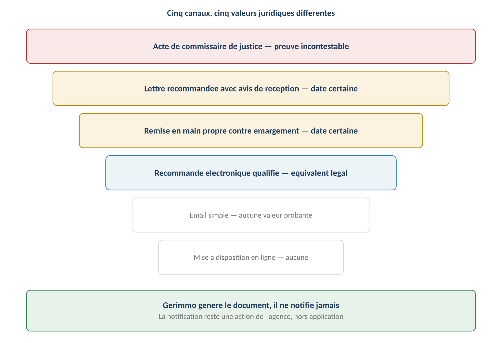

# Notification et valeur probante

**Énoncé :** **Gerimmo génère et suit, il ne notifie jamais** (RM-A3.1) — et **aucune
trace GED ne constitue une preuve juridique** (RM-A3.2). Pour les actes à effet
juridique, la notification passe par un canal légal hors plateforme, et c'est **la
première présentation qui fait courir le délai** (RM-A3.5).
Source : [[2026-07-24-gerimmo-v3-a3-documents-canaux-preuve|Livrable A3]].

## Les cinq niveaux de preuve

1. **Acte de commissaire de justice** — date et contenu incontestables.
2. **LRAR** — date certaine (première présentation).
3. **Remise en main propre contre émargement** — date certaine.
4. **Email simple** — aucune valeur probante pour un acte à effet juridique.
5. **Mise à disposition en ligne** — aucune valeur probante, même avec trace d'ouverture.

## Les quatre dates d'un acte notifié

| Date | Effet juridique |
|---|---|
| Génération du document (Gerimmo) | Aucun |
| Envoi postal (récépissé de dépôt) | Aucun pour le destinataire |
| **Première présentation** (avis de réception) | **Le délai court** |
| Retrait effectif | Aucun — la présentation suffit |

Un locataire qui ne retire pas sa LRAR ne bloque pas le délai. **L'agent saisit la date
de première présentation** lue sur l'avis de réception (RM-A3.4) ; les délais sont
calculés **depuis la date saisie, jamais depuis l'envoi** (RM-A3.6).

## La frontière outil / acte

| Action | Gerimmo | L'agence |
|---|---|---|
| Générer le document conforme, vérifier les mentions | **Oui** | Contrôle |
| **Notifier au destinataire** | **Jamais** | **Oui** |
| Saisir la date de présentation | Enregistre | **Saisit** |
| Calculer les délais, alerter aux échéances | **Oui** | Vérifie |
| Conserver l'avis de réception | Peut le stocker | Détient l'original |
| **Prouver l'envoi** | **Jamais** | Par l'avis |

## La matrice par famille de documents

**Famille 1 — Actes à effet juridique** (canal légal imposé, RM-A3.3) :

| Document | Canal | Date qui compte |
|---|---|---|
| Congé du bailleur / du locataire | **LRAR ou acte** | Première présentation |
| Mise en demeure ([[Relances et mise en demeure]]) | **LRAR** | Première présentation |
| Décompte de restitution | LRAR recommandé | **Remise des clés** (RM-2.4.1) |
| Régularisation de charges ([[Régularisation des charges]]) | Email accepté | Envoi |

**Famille 2 — Documents engageants** ([[Signature électronique]] chez **Zoho Sign**
depuis le 18/10/2026 — et non plus Yousign, retiré : invitation par courriel, code à usage
unique par SMS, ordre séquentiel, propriétaires en dernier ; **Zoho Sign délivre le
certificat de fin de signature, commun à tous les signataires**, que Gerimmo enregistre
avec le PDF signé dans les Documents) :

| Document | Canal | Preuve |
|---|---|---|
| [[Bail]] et avenants | Zoho Sign ; ou papier, puis dépôt du PDF signé | PDF signé et certificat commun ; le garant qui signe le bail confirme lui-même son mobile (choix du 24/10) |
| Acte de cautionnement | Zoho Sign, **la caution confirme elle-même son numéro de mobile** avant l'envoi et saisit elle-même sa mention ; ou papier | PDF signé et certificat commun ; journal d'audit de la confirmation du mobile (dix ans) |
| Accord d'échelonnement, accord de travaux, acceptation d'un devis d'artisan | Zoho Sign ; ou papier | PDF signé et certificat commun |
| **État des lieux** | **Zoho Sign, avec la confirmation du bailleur qu'il a été « établi contradictoirement, sur place, le {date}, en présence du locataire ou de son représentant »** ; ou signé sur place sur papier, puis dépôt du document signé ou du constat d'un commissaire de justice | PDF signé et certificat commun, plus la confirmation sur place (texte, date, instant, auteur) gardée sur le circuit et au journal d'audit ; ou pièce déposée en GED (règle du 29/09) |
| Mandat de gestion | **Hors circuit de signature** (agences retirées de l'offre) | — |

**Valeur de cette signature.** Ce n'est pas une signature électronique qualifiée au sens
du règlement eIDAS : elle **ne bénéficie d'aucune présomption de fiabilité** ; en cas de
contestation, sa fiabilité s'apprécie au vu du PDF signé et du certificat commun. Le code
SMS atteste que le signataire disposait du téléphone indiqué, pas son identité civile —
d'où la confirmation du mobile par la caution et le garant eux-mêmes, jamais le numéro
saisi par le bailleur. L'image de signature apposée sur les documents courants n'est pas
une signature électronique (Famille 3).

**L'état des lieux.** Le référentiel (RM-A3.7, RM-13.1.6) voulait un « consentement
recueilli en présence », hors signature électronique. La **décision du dirigeant du
23/10/2026** (« le cautionnement et l'état des lieux doivent etre signé sur gerimmo
directement ! ») le fait signer dans Gerimmo ; la présence reste au cœur de sa valeur, par
la case « établi contradictoirement, sur place » (date de la visite = date portée par
l'état des lieux, préremplie et verrouillée ; refusée par le serveur et par la base sans
elle). Cette décision remplace la variante « signé sur place puis déposé » du plan du 23/10.
Pour un état des lieux d'entrée, le PDF et l'invitation rappellent au locataire son droit
de demander qu'il soit complété **dans les dix jours qui suivent son établissement** et,
pour le chauffage, pendant le premier mois de la période de chauffe.

**Famille 3 — Documents courants** (email ou espace personnel, aucune preuve requise,
RM-A3.8) : quittance, reçu, appel de loyer ([[Quittancement des loyers]]), relance
simple, rapport de gestion, récapitulatif fiscal, devis/facture, diagnostic (annexé au
[[Bail]], le bail fait foi).

## Documents financiers du propriétaire : pièce jointe assumée

Décision **confirmée après deux audits** : envoi en **pièce jointe email, sans lien
sécurisé** (RM-A3.9). Zéro stockage temporaire, zéro expiration, zéro développement ;
en contrepartie : circulation en clair, **ni révocation ni trace de consultation**
(RM-A3.11). Le lien sécurisé reste une évolution possible, ni V1 ni commercialisation.
Voir [[Propriétaire bailleur]].

## Ce que l'agent saisit

| Champ | Pour quels documents | Obligatoire |
|---|---|---|
| Date de notification + canal | Actes à effet juridique | **Oui** |
| N° de recommandé, avis scanné | Si LRAR | Recommandé (RM-A3.10) |
| Date d'envoi | Documents courants | Automatique |

La saisie facultative **protège l'agence** : reconstituer le dossier en cas de litige,
prouver ses diligences (même logique que la trace des relances).
Cas concret (module 0b) : les **alertes d'assurance** envoyées au locataire sont
**horodatées et conservées** (RM-0b.6.2) — le bailleur ne peut invoquer le défaut
d'assurance que s'il prouve avoir réclamé le document ([[Dossier locataire]]).

> [!info] Application — intention de congé (2026-09-06)
> L'audit du 06/09 a révélé que le portail locataire **fabriquait** une date de
> première présentation (congé « remis par l'espace ») — contraire à RM-A3.1/A3.5.
> **Corrigé (carte blanche)** : le portail n'enregistre plus qu'une **intention
> de congé** (table `intentions_conge`, alerte `conge_intention` au gestionnaire,
> mot du locataire transmis) ; le congé lui-même reste au **LRAR**, enregistré
> par le gestionnaire avec la date de première présentation (`enregistrer_conge`),
> qui solde l'intention. La règle est désormais respectée des deux côtés.

> [!warning] Points à trancher / réserves
> - **Rattachement prioritaire n° 1 de la [[2026-07-24-gerimmo-v3-matrice-tracabilite|matrice de traçabilité]]** :
>   le champ « **date de première présentation** » (RM-A3.5) manque encore aux modules 1
>   (congé) et 2 (décompte) — « le rattachement le plus concret de cette matrice ».
> - **Matrice à faire valider par un conseil juridique** (canaux imposés, dates d'effet).
> - Piste : le **recommandé électronique qualifié** pourrait remplacer la LRAR pour
>   certains actes — vérification juridique préalable requise.
> - La trace GED du module 12 (« fonde les délais ») est **à reformuler** dans le
>   référentiel — voir [[Document]].
> - **24/10 — valeur probante d'une signature par code SMS** pour l'acte de cautionnement et
>   l'état des lieux : risque résiduel signalé par le dirigeant lui-même (23/10), à faire relire
>   par un juriste — à confirmer sur Légifrance (source non ouverte le 23/10/2026) : C. civ.
>   1366, 1367, 1375, 2297 ; décret 2017-1416 ; loi 89-462 art. 3-2 et 22-1 ; décret 2016-382 ;
>   règlement (UE) 910/2014 art. 25-26.
> - **24/10 — « signature simple »** : le référentiel (RM-13.1.1) emploie ce mot ; le plan du
>   23/10 a retiré « signature simple au sens du règlement », catégorie non sourcée : la page dit
>   seulement « non qualifiée, sans présomption de fiabilité ».
> - **24/10 — remise d'un exemplaire signé à chaque partie** (C. civ. 1375 ; loi 89-462 art. 3-2
>   et 22-1) : la recette Zoho à trois signataires (bailleur, locataire, garant) n'est pas faite ;
>   si Zoho ne remet pas l'exemplaire, Gerimmo devra l'envoyer lui-même.
> - **24/10 — délai de complément de l'état des lieux** : « dix jours qui suivent son
>   établissement » (choix délégué n° 8 du 24/10) ou « de sa signature » — à confirmer sur
>   Légifrance (source non ouverte le 23/10/2026).

## Précisions (2026-09-09)

- La **signature préenregistrée** apposée sur les documents émis seuls
  (quittance, reçu, courrier — [[Signature électronique]]) n'ajoute **aucune**
  valeur probante : ces documents relèvent de la Famille 3 (« aucune preuve
  requise », RM-A3.8) et la loi n'exige pas de signature sur une quittance
  ([[Quittance conforme]]).
- La **mise à disposition** d'un courrier dans l'espace locataire
  ([[Document]]) n'est **pas** une notification : Gerimmo génère et suit, il ne
  notifie jamais (RM-A3.1) — la LRAR reste le canal des actes.

## Relecture avant publication du 24 octobre

Voir [[Relecture adverse et publication conformité V1 — 24 octobre 2026]] pour les sources officielles consultées, les corrections retenues et les réserves encore ouvertes. Les mentions « non publié » ci-dessus décrivent l’état avant la mise en ligne ; seule une entrée `deploy` du journal en atteste l’achèvement.
